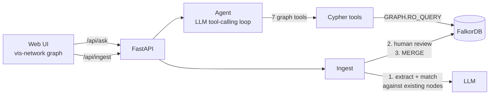
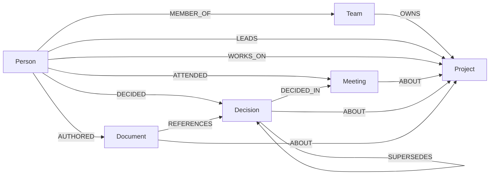

# TeamBrain — a company brain on FalkorDB

**Track:** Company Brain · **Graph Hacks** (WeMakeDevs × FalkorDB, Oct 2026)

TeamBrain answers the questions that new joiners, managers and auditors actually ask —
*who owns this, what did we decide, why did it change, who should I talk to* — by
walking a graph of people, teams, projects, meetings, decisions and documents.
Every answer cites the graph nodes it came from and shows the Cypher that produced it.
Paste new meeting notes and the brain updates itself, including marking old decisions
as superseded.

- **Live demo:** _add your Render URL here_
- **Demo video:** _add your video link here_


## Why this needs a graph

The useful answers live in the **relationships**, not in any single document:

| Question | Graph walk |
|---|---|
| Why is the fraud auto-block threshold 0.78? | `Decision -SUPERSEDES-> Decision`, `-DECIDED_IN-> Meeting <-ATTENDED- Person` |
| Who should I ask about the ledger migration? | Rank people by `LEADS`, `WORKS_ON`, `DECIDED`, `AUTHORED`, `ATTENDED` paths into the project |
| How is Sana connected to the fraud threshold decision? | Shortest paths up to 4 hops between the two nodes |
| What's the current autopay limit? | Active decision on the project, following `SUPERSEDES` back to what it replaced |

Remove FalkorDB and nothing works: the agent has no other source of truth, and is
told never to answer from outside knowledge.

## Architecture



- **Agent** (`teambrain/agent.py`): an LLM with 7 graph tools. It resolves names to node
  ids, picks the right traversal, and must cite node ids like `[d-4]` for every fact.
- **Tools** (`teambrain/tools.py`): each is one Cypher query. All reads go through
  FalkorDB's `GRAPH.RO_QUERY`, so even the free-form `run_cypher` tool cannot write.
- **Ingest** (`teambrain/ingest.py`): meeting notes → LLM extraction using the graph's
  existing people/projects/decisions as context → ids validated in Python → shown to
  the user → written with `MERGE` (idempotent). New decisions can `SUPERSEDE` old ones.
- **UI** (`static/index.html`): chat, citations that highlight nodes in the graph,
  the Cypher behind each answer, and the ingest review screen.

## Graph data model



| Label | Properties |
|---|---|
| `Person` | `id`, `name`, `role` |
| `Team` | `id`, `name` |
| `Project` | `id`, `name`, `status`, `summary` |
| `Meeting` | `id`, `title`, `date`, `notes` |
| `Decision` | `id`, `title`, `rationale`, `date`, `status` (`active` / `superseded`) |
| `Document` | `id`, `title`, `kind`, `url`, `summary` |

Every label has a range index on `id`. All Cypher the product depends on is in
[QUERIES.md](QUERIES.md).

## Run it locally

Requires Python 3.11+ and a FalkorDB instance (free [FalkorDB Cloud](https://app.falkordb.cloud)
or `docker run -p 6379:6379 -p 3000:3000 falkordb/falkordb:latest`), plus a free
[Gemini API key](https://aistudio.google.com/apikey) (any OpenAI-compatible LLM works).

```bash
git clone https://github.com/aaryn01/teambrain.git && cd teambrain
python3 -m venv .venv && source .venv/bin/activate
pip install -r requirements.txt
cp .env.example .env          # fill in FalkorDB + LLM settings
python seed.py                # loads the demo company (safe to re-run)
uvicorn main:app --reload     # open http://localhost:8000
```

Try the example questions, then open **Update the brain** → **Load sample notes** →
**Extract updates** → **Write to graph**, and ask *"What's the current autopay limit?"* again.

Agent from the terminal: `python -m teambrain.agent "Who should I ask about the ledger?"`

Tests (no DB or LLM needed): `pip install pytest && python -m pytest -q`

## Deploy

`render.yaml` deploys the app to Render's free tier: **New → Blueprint**, pick this repo,
and fill in the `FALKORDB_*` and `LLM_API_KEY` secrets. The graph itself lives on FalkorDB Cloud.

## Project layout

```
main.py                 FastAPI app and endpoints
seed.py                 python seed.py  -> rebuild demo graph
teambrain/db.py         FalkorDB connection, read-only query helper
teambrain/tools.py      the agent's Cypher tools
teambrain/agent.py      tool-calling agent with citations
teambrain/ingest.py     meeting notes -> reviewed graph updates
teambrain/seed_data.py  synthetic company data
static/index.html       UI
tests/                  offline tests
```

## Data

All data is **synthetic**. Northwind Pay and everyone in it are fictional.

## AI assistance disclosure

Built with help from Claude (Anthropic) as an AI coding assistant for code generation
and review. I designed the graph model and queries with it, tested every
query against FalkorDB, and can explain each part of the system.
